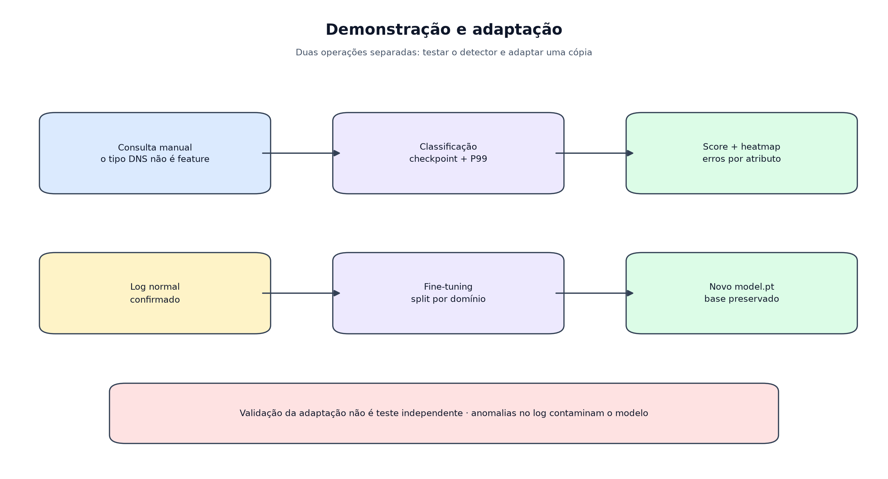
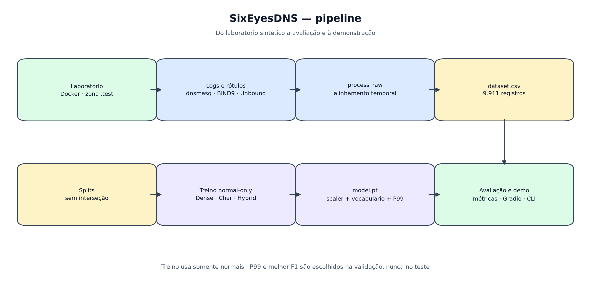
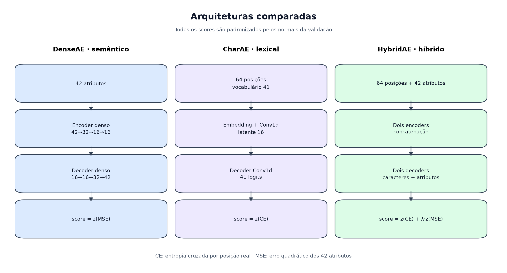
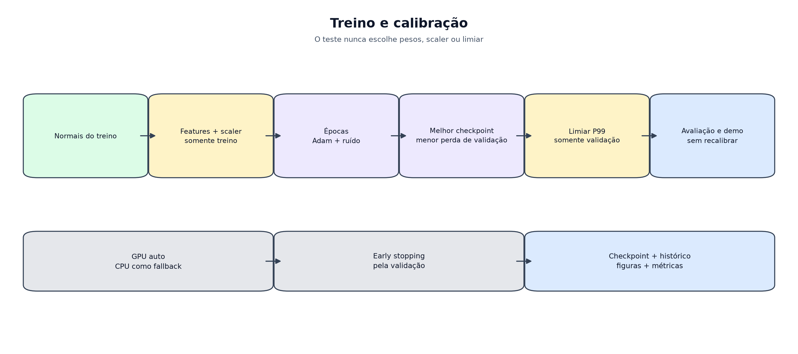

# SixEyesDNS

Detector educacional de consultas DNS anômalas com autoencoders. Projeto da
Unidade III de **Aprendizado Profundo 2026.2**, categoria **Autoencoders para
Anomalias e Ruído**. O [requisito da disciplina](doc/info/Descricao_do_Trabalho.md)
está no repositório.

## Introdução

Tunelamento DNS pode esconder dados em nomes de domínio. O SixEyesDNS aprende a
reconstruir consultas normais e usa o erro de reconstrução para sinalizar nomes
fora do padrão. O laboratório gera somente tráfego sintético `.test`; nenhum
servidor consulta a Internet.

O modelo analisa **somente o domínio**. IP, cliente, rótulo, família e tipo DNS
são metadados, não features. Por isso trocar `A` por `TXT` sem mudar o domínio
não altera o score — uma decisão contra atalhos como “TXT é suspeito”, não um
bug da demonstração.

## Demonstração

### Gradio e Hugging Face Space

```bash
./scripts/demo/gradio.sh
# http://127.0.0.1:7860
```

A interface oferece duas operações:

- **Testar modelo:** escolher HybridAE, CharAE ou DenseAE, informar um domínio e
  ver score, limiar P99, heatmap por caractere e erros por atributo.
- **Fine-tuning com log normal:** adaptar uma cópia do checkpoint com dnsmasq,
  BIND9 ou Unbound e baixar o novo `model.pt`.

O log de adaptação precisa conter **somente normais confirmados**. Anomalias no
arquivo ensinam o autoencoder a reconstruir o túnel como legítimo. A adaptação
separa domínios entre treino e validação, ajusta o scaler no treino, escolhe o
melhor checkpoint pela validação e recalcula o P99 nela. Não produz acurácia de
teste: isso exige dados independentes. Veja o [protocolo completo](doc/fine-tuning.md).
A aba traz um log normal pronto para testar (`scripts/demo/normal-example.txt`,
600 domínios únicos do laboratório).



O repositório contém `app.py`, os checkpoints e os metadados do Space. Para
publicar, crie um Space Gradio, monte a pasta com só o que o app usa (código,
checkpoints e exemplos, sem dados nem figuras) e envie-a com a CLI do Hub:

```bash
./scripts/demo/space-bundle.sh        # gera build/space
hf auth login                         # token do Hub, fora do repositório
hf upload <usuario>/<space> build/space . --repo-type=space --exclude .space-bundle
```

Em vez de `git push`, que levaria o histórico inteiro com PNG, GIF e dados, o
`hf upload` envia só a pasta gerada. A publicação não é automática. Nenhum Space
público é presumido neste README.

### Replay offline no terminal

A classificação de logs, separada do fine-tuning, continua disponível sem Docker:

```bash
./scripts/demo/demo.sh
LIMIT=2 ./scripts/demo/demo.sh
REPLAY_LOG=data/raw/dnsmasq/dnsmasq.log LIMIT=20 ./scripts/demo/demo.sh
```

O exemplo versionado contém nove consultas do teste e inclui um falso positivo
conhecido. Use `--json` para obter o relatório completo.

## Desenvolvimento e técnicas



O pipeline reúne laboratório Docker, logs dnsmasq/BIND9/Unbound, alinhamento de
logs e rótulos, splits sem interseção de domínios, três autoencoders, avaliação
e demonstração. O dataset versionado tem 9.911 registros e 6.924 domínios
únicos. O alinhamento corrigido gera 10.000 linhas, mas regenerar mudaria os
splits e invalidaria os checkpoints; a decisão continua no [roadmap](roadmap.md).

### Representação e modelos

- 64 posições de caracteres e 42 atributos lexicais: seis escalares e 36
  frequências de `a-z`/`0-9`.
- **DenseAE:** reconstrói os atributos e usa MSE.
- **CharAE:** reconstrói a sequência e usa entropia cruzada por posição real.
- **HybridAE:** combina `z(CE) + lambda*z(MSE)` com estatísticas dos normais da
  validação.
- Entropia de Shannon e Isolation Forest servem como baselines.



O treino usa Adam, seed 42, somente normais do treino, máscara/ruído de entrada e
early stopping pela validação. O checkpoint guarda pesos, scaler, vocabulário,
arquitetura, estatísticas e limiar. GPU é preferida quando disponível; CPU é o
fallback automático.



Detalhes de [arquitetura](doc/arquitetura.md) e do
[laboratório/processamento](doc/laboratorio.md) ficam fora deste resumo.

## Resultados

Teste por registro, limiar P99 dos normais da validação. Fonte:
[`results/evaluation/metrics.csv`](results/evaluation/metrics.csv).

| Sistema | Precisão | Recall | F1 | FPR | ROC-AUC |
|---|---:|---:|---:|---:|---:|
| Entropia | 0.9838 | 0.1873 | 0.3147 | 0.0107 | 0.6712 |
| Isolation Forest | 0.9840 | 0.4513 | 0.6188 | 0.0254 | 0.9396 |
| DenseAE | 0.9986 | 0.5592 | 0.7169 | 0.0027 | 0.9901 |
| CharAE | 1.0000 | 1.0000 | 1.0000 | 0.0000 | 1.0000 |
| HybridAE | 0.9973 | 1.0000 | 0.9987 | 0.0093 | 1.0000 |

O CharAE não erra nesse teste. O HybridAE detecta as mesmas 2.595 suspeitas,
mas sinaliza sete domínios normais `normal_hard` no P99; com o limiar de melhor
F1, sobra um falso positivo. Portanto, os dados não sustentam chamar o híbrido
de “o melhor modelo”.

O teste tem 77,6% de suspeitas, muito acima do esperado em tráfego real. Com
recall 1 e FPR 0,0093, a precisão esperada do HybridAE cai para **0,5194 com 1%
de suspeitas** e **0,0967 com 0,1%**. F1 alto não basta para decidir uso real.

As tabelas por registro/domínio, as duas políticas de limiar, ablação, LOFO,
prevalência, explicabilidade e falsos positivos estão em
[`results/evaluation/summary.md`](results/evaluation/summary.md) e nos demais
artefatos de [`results/evaluation/`](results/evaluation/).

## Aplicações na vida real

O projeto pode ser usado como **sinal auxiliar de priorização**, não como prova
de ataque:

1. **Triagem em SOC:** ordenar logs por score para um analista revisar primeiro
   os nomes mais anômalos, junto de ativo, destino e outras evidências.
2. **Baseline de uma rede:** adaptar o modelo a normais confirmados de um
   ambiente e detectar mudanças de padrão, com validação independente.
3. **Observabilidade em resolvedor/gateway:** exportar score e explicações para
   SIEM ou outra ferramenta, sem bloquear automaticamente.
4. **Pesquisa e ensino:** reproduzir famílias sintéticas, medir FPR e estudar o
   mecanismo de autoencoders sem tráfego contra terceiros.

Ele não detecta todo túnel: domínios lexicalmente comuns, payload somente na
resposta, tráfego direto por IP e nomes invisíveis ao ponto de coleta ficam fora
do alcance. DoH/DoT exige instrumentar um ponto que veja os domínios. Integrações
com Zeek, Suricata ou SIEM seriam por logs/API própria; o projeto ainda não é um
plugin desses sistemas.

O [guia de aplicações reais](doc/aplicacoes.md) detalha arquitetura de
implantação, privacidade, limites e o protocolo para uma prova de conceito.

## Análise crítica

- **Dataset sintético e fácil:** ROC-AUC 1 no laboratório não comprova eficácia
  em tráfego real.
- **Similaridade de moldes:** splits não repetem domínios, mas compartilham
  padrões do gerador. A diversidade dos normais é o gargalo principal.
- **Falsos positivos:** hashes legítimos de CDN podem parecer payloads; o
  exemplo `f4bfff32c5.cdn.brisa` deixa isso visível na demo.
- **Prevalência:** com ataques raros, a maioria dos alertas pode ser falsa.
- **Uma seed e um split:** faltam intervalos de confiança e avaliação temporal.
- **Fine-tuning contaminado:** adaptar com anomalias pode destruir a utilidade
  do detector. Validação de treino não substitui teste independente.
- **Escopo lexical:** o modelo não vê conteúdo da resposta nem prova exfiltração.

## Conclusões

1. CharAE e HybridAE superam os baselines neste conjunto, mas o CharAE é o
   melhor resultado medido; o híbrido não o supera.
2. O limiar e a prevalência importam tanto quanto a arquitetura. F1 isolado
   distorce a leitura quando a distribuição real é desbalanceada.
3. O projeto entrega um laboratório, um método auditável, uma interface Gradio
   e um mecanismo controlado de adaptação — não um produto pronto para bloqueio.
4. A aplicação mais responsável hoje é priorização para análise humana. Uso real
   exige dados do ambiente, teste independente, múltiplas seeds/períodos e
   governança dos logs.

## Como reproduzir

```bash
conda env create -f environment.yml
conda activate sixeyesdns

./scripts/model/train-lexical.sh
./scripts/model/train-semantic.sh
./scripts/model/train-hybrid.sh
./scripts/evaluate/evaluate.sh
python -m pytest -q
```

Para recriar os dados sintéticos, consulte [doc/laboratorio.md](doc/laboratorio.md).
As figuras da documentação são PNGs gerados com Matplotlib, sem Mermaid:

```bash
python -m source.doc_figures
```

## Estrutura principal

```text
app.py                    # entrada do Space Gradio
source/                   # features, modelos, treino, avaliação e demos
scripts/demo/             # Gradio e replay offline
data/processed/           # dataset e splits versionados
results/                  # checkpoints e avaliação verificável
doc/                      # guias e figuras Matplotlib
tests/                    # testes unitários e de integração
```

## Segurança e ética

- Tráfego apenas local, sintético e `.test`; nenhuma exfiltração real.
- Não versionar credenciais, dados pessoais ou datasets externos.
- Logs DNS são sensíveis: retenção, acesso e finalidade precisam de governança.
- O score prioriza investigação; não é prova de ataque nem autorização para
  bloqueio automático.

## Referências

- [PyTorch](https://pytorch.org/) — modelos e inferência.
- [scikit-learn](https://scikit-learn.org/) — scaler e Isolation Forest.
- [NumPy](https://numpy.org/) e [Matplotlib](https://matplotlib.org/) — cálculo
  e figuras, incluindo os diagramas desta documentação.
- [Gradio](https://www.gradio.app/) — interface web e Space.
- [Dnsmasq](http://thekelleys.org.uk/dnsmasq/),
  [BIND9](https://www.isc.org/bind/),
  [Unbound](https://nlnetlabs.nl/projects/unbound/) e
  [Kea](https://kea.isc.org/) — laboratório local.
- [Tranco](https://tranco.org/) — ranking opcional, somente quando fornecido
  localmente pelo autor.
