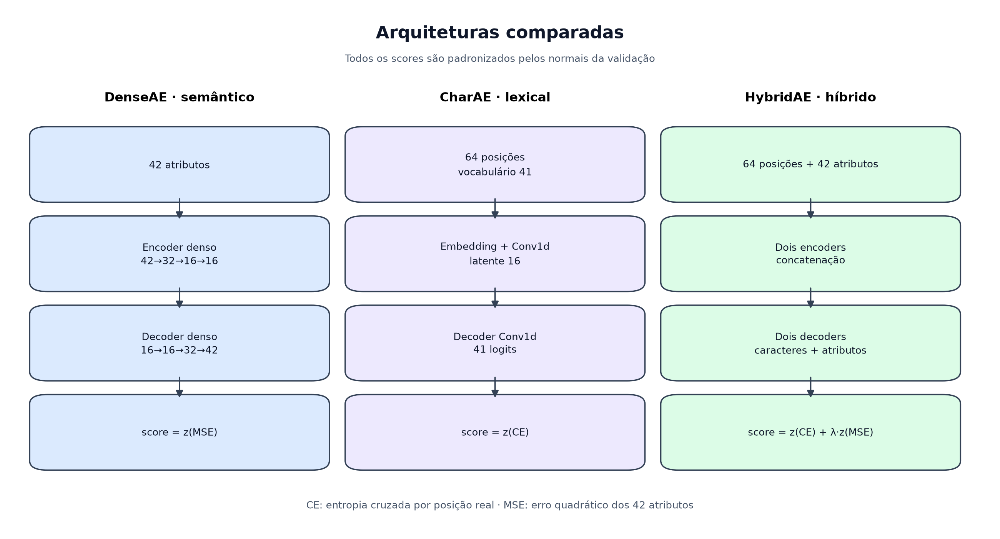
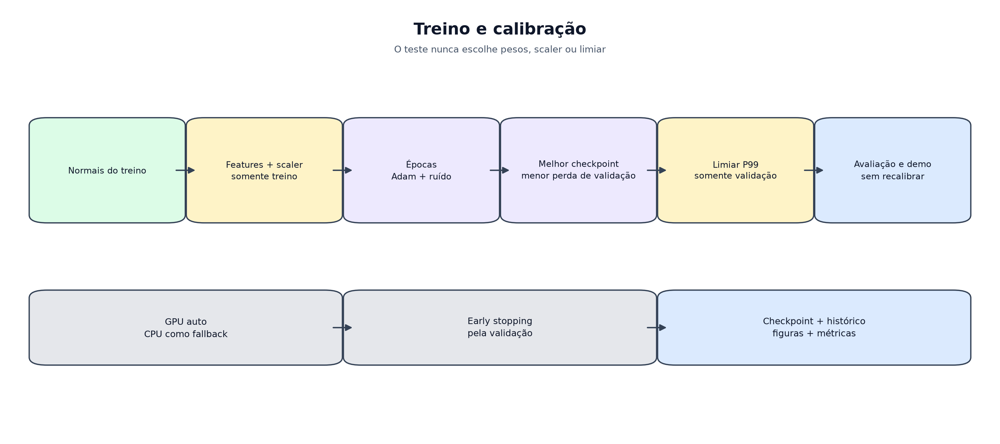

# Arquitetura e protocolo de treino

## Representação

`source/features.py` é a fonte única de normalização, tokenização e atributos.
O domínio fica em minúsculas, sem ponto final e sem o sufixo de laboratório
`.test`. A sequência é truncada/preenchida para 64 posições.

Os 42 atributos numéricos são seis escalares — comprimento, entropia, proporção
de dígitos, quantidade de labels, maior label e proporção alfanumérica — e 36
frequências de `a-z` e `0-9`. `label`, `family`, `query_type`, `seed`, IP e
cliente são metadados e não entram no modelo. Por isso trocar A por TXT sem
mudar o domínio não altera o score.

## Modelos

- **DenseAE:** reconstrói os 42 atributos e usa MSE como score.
- **CharAE:** reconstrói a sequência de caracteres e usa entropia cruzada média
  nas posições reais.
- **HybridAE:** combina os dois ramos por `z(CE) + lambda*z(MSE)`. As médias e
  desvios da padronização do score vêm dos normais da validação.

## Treino e avaliação

O treino usa Adam, seed 42, somente normais do split de treino, ruído/máscara de
entrada e early stopping pela perda de validação. O checkpoint contém pesos,
scaler, vocabulário, arquitetura, estatísticas do score e limiar P99.

A avaliação calcula P99 e melhor F1 somente na validação e aplica esses limiares
ao teste. Também mede ROC-AUC, PR-AUC, recall a FPR de 1%, métricas por registro
e domínio único, ablação, leave-one-family-out, falsos positivos por perfil,
prevalência esperada e similaridade por moldes. Os artefatos estão em
[`../results/evaluation/`](../results/evaluation/).

## Fine-tuning

A adaptação com log normal reutiliza a perda original, mas separa novos domínios
entre treino e validação e nunca sobrescreve o checkpoint base. O protocolo e
seus limites estão em [fine-tuning.md](fine-tuning.md).
