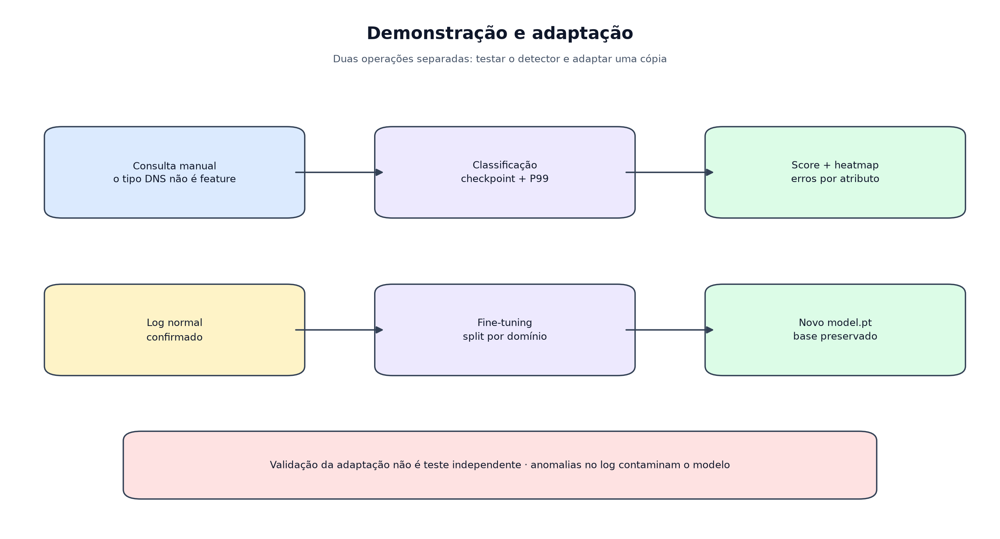

# Demonstração: Gradio, Space e replay

A demonstração é um extra da entrega: a avaliação do trabalho é feita pelo texto
e pelas métricas (veja o [README](../README.md)). A interface existe para mostrar
o modelo funcionando, na sala ou no navegador.

## Gradio local

```bash
./scripts/demo/gradio.sh
# http://127.0.0.1:7860
```

A interface oferece duas operações:

- **Testar modelo:** escolher HybridAE, CharAE ou DenseAE, informar um domínio e
  ver score, limiar P99, mapa de erro por caractere e erros por atributo.
- **Fine-tuning com log normal:** adaptar uma cópia do checkpoint com um log do
  dnsmasq, BIND9 ou Unbound e baixar o novo `model.pt`.

O log de adaptação precisa conter **somente normais confirmados**. Anomalias no
arquivo ensinam o autoencoder a reconstruir o túnel como legítimo. A adaptação
separa domínios entre treino e validação, ajusta o scaler no treino, escolhe o
melhor checkpoint pela validação e recalcula o P99 nela. Não produz acurácia de
teste: isso exige dados independentes. O
[protocolo completo](fine-tuning.md) tem os detalhes. A aba traz um log normal
pronto para testar (`scripts/demo/normal-example.txt`, 600 domínios únicos do
laboratório).

A adaptação é o passo que torna o detector utilizável fora do laboratório: o
modelo base sinaliza quase todos os nomes reais populares (veja a seção
"Nomes reais" do README). Esse efeito ainda não foi medido depois de adaptar.



## Publicar no Hugging Face Space

O repositório contém `app.py`, os checkpoints e os metadados do Space no
*front matter* do `README.md`. Para publicar, crie um Space Gradio, monte a pasta
com só o que o app usa (código, checkpoints e exemplos, sem dados nem figuras) e
envie-a com a CLI do Hub:

```bash
./scripts/demo/space-bundle.sh        # gera build/space
hf auth login                         # token do Hub, fora do repositório
hf upload <usuario>/<space> build/space . --repo-type=space --exclude .space-bundle
```

Em vez de `git push`, que levaria o histórico inteiro com PNG, GIF e dados, o
`hf upload` envia só a pasta gerada. A publicação não é automática e depende da
conta do autor; nenhum Space público é presumido na documentação.

## Replay offline no terminal

A classificação de logs, separada do fine-tuning, funciona sem Docker:

```bash
./scripts/demo/demo.sh
LIMIT=2 ./scripts/demo/demo.sh
REPLAY_LOG=data/raw/dnsmasq/dnsmasq.log LIMIT=20 ./scripts/demo/demo.sh
```

O exemplo versionado (`scripts/demo/replay-example.txt`) contém nove consultas
do teste, nos três formatos de log, e inclui um falso positivo conhecido. Use
`--json` para obter o relatório completo. O replay não usa rótulos nem
recalibra o limiar.
