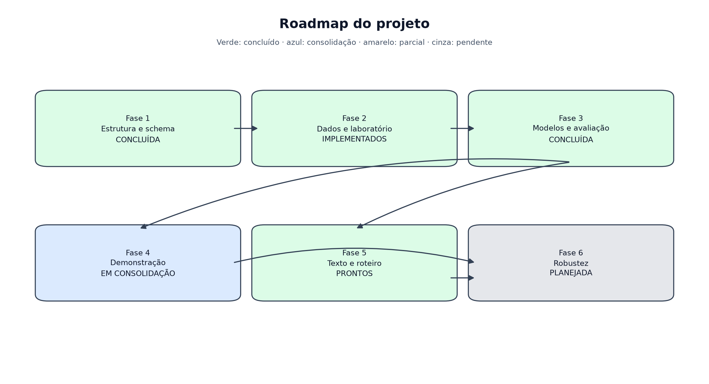
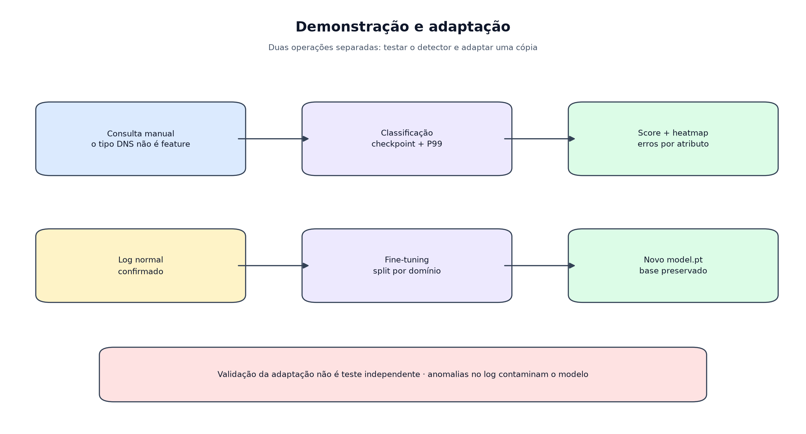

# Roadmap do SixEyesDNS

## Objetivo e prazo

Concluir o projeto individual da Unidade III de **Aprendizado Profundo
2026.2**, categoria **Autoencoders para Anomalias e Ruído**.

- apresentação presencial: 08, 10 ou 15/12/2026;
- texto no repositório: 15/12/2026;
- demonstração offline ou local como entrega central da apresentação.

O requisito acadêmico está em
[doc/info/Descricao_do_Trabalho.md](doc/info/Descricao_do_Trabalho.md).

## Estado atual

A consolidação do laboratório, dos modelos, da avaliação e da documentação foi
mergeada na branch `master` pela PR #1 (08/11/2026). O texto da disciplina está
consolidado no [README](README.md), com introdução, técnicas, resultados, análise
crítica e conclusões — as cinco partes do escopo escrito. Esse texto ainda está
na branch `docs/atualizar-readme-roadmap`, não mergeada, e a entrega é lida na
`master`.

Fases 1 a 3 e o texto da Fase 5 estão concluídos. A demonstração offline da
Fase 4 está implementada; restam a publicação e a verificação do Space, o
roteiro da apresentação, a regeneração do dataset e a consolidação final na
`master`.

## Decisões do autor (24/11/2026)

- **Entrega:** o professor lê o repositório na `master`; o texto consolidado e a
  demonstração precisam estar nela antes de 15/12.
- **Apresentação:** presencial, no laboratório da sala (máquinas Ryzen 7 5700G
  com 16 GB de RAM). O foco é falar do projeto, mostrar a arquitetura e contar
  o desenvolvimento; a demonstração roda pelo Space no navegador. Docker,
  geração do dataset e treino não fazem parte da apresentação.
- **Space no Hugging Face:** é um extra do projeto, mas é o meio de
  demonstração na sala.
- **Dataset:** será regenerado, mais completo e variado, com tráfego que lembre
  uma rede em funcionamento (Fase 2).
- **Modelo híbrido:** o autor quer defender o híbrido pela hipótese de que mais
  informação para reconstruir o torna mais capaz de identificar domínios
  suspeitos. A hipótese e o que os dados atuais dizem sobre ela estão na
  Fase 6.

## Diagnóstico concluído

- [x] Confirmar que o repositório usa `source/`, não `src/`.
- [x] Localizar o gerador em `docker/generator/gerador_queries.py`.
- [x] Confirmar que o dataset versionado possui 50.000 registros.
- [x] Regenerar o dataset limpo com 10.000 consultas do laboratório ampliado.
- [x] Confirmar 42 atributos lexicais e 58 colunas no schema da época (hoje o
      `dataset.csv` tem 59, com `profile`).
- [x] Confirmar que `.test` é removido da coluna de domínio processada.
- [x] Confirmar ausência de interseção de domínios entre os splits atuais.
- [x] Identificar somente 126 domínios normais únicos no gerador atual.
- [x] Identificar log concatenado: 60.000 consultas para 50.000 rótulos.
- [x] Identificar que o casamento atual usa domínio e tipo, sem timestamp.
- [x] Planejar e implementar serviços fictícios, Nginx e dashboard local.
- [x] Ampliar famílias sintéticas e perfis normais difíceis sem tráfego externo.
- [x] Confirmar funcionamento da porta `127.0.0.1:6767` com uma ferramenta DNS
      disponível (consulta crua UDP/TCP; no Docker Desktop foi preciso ligar o
      dnsmasq à rede de borda `lab-edge`, pois portas de containers presos só
      à rede interna não chegam ao host).

## Fase 1 — Estrutura e schema

Status: **concluída**; modelos retreinados sem os indicadores de tipo DNS.

- [x] Trabalhar na branch `ajustes-u3`.
- [x] Manter os módulos executáveis com `python -m source.<modulo>` nos
      scripts de treino e plotagem.
- [x] Manter `source/features.py` como origem dos atributos usados no treino.
- [x] Adicionar `source/__init__.py`.
- [x] Consolidar completamente em `source/features.py` a normalização,
      tokenização, vocabulário e os 42 atributos numéricos.
- [x] Separar explicitamente features e metadados.
- [x] Rejeitar automaticamente `label`, `family`, `query_type`, `seed`, IP e
      cliente na matriz de entrada.
- [x] Remover os indicadores de tipo DNS (`is_A`, `is_TXT` etc.) das features,
      pois derivam de `query_type`, que é metadado; retreinar os modelos após
      a correção.
- [x] Fazer `process_raw.py` e `split_dataset.py` funcionarem com
      `python -m source.<modulo>`.
- [x] Adicionar `--holdout-family`.
- [x] Expandir `summary.json` com linhas e domínios únicos por split, classe e
      família.
- [x] Adicionar testes de determinismo, ausência de metadados e ausência de
      interseção.
- [x] Mover `VL.py` para `scripts/check_env.py`.
- [x] Fixar dependências e incluir pytest, scikit-learn e matplotlib quando
      realmente usados.

## Fase 2 — Dados

Status: laboratório, dataset sintético e alinhamento logs-rótulos
implementados; a regeneração do dataset versionado foi decidida em 24/11/2026
e ainda não foi feita.

- [x] Corrigir o alinhamento entre logs e rótulos e documentar o tratamento de
      execuções concatenadas e duplicadas (`source/process_raw.py`: casa por
      servidor-alvo, IP do gerador, janela de tempo e `(query, tipo)`; falha em
      rótulos concatenados ou conflitantes; relatório em `alignment.json`).
- [x] Alinhar README, compose e scripts quanto a `QUERY_COUNT`,
      `ANOMALY_RATE` e `SEED`.
- [x] Decidir se o dataset versionado será regenerado. **Decisão do autor
      (24/11/2026): regenerar**, com um laboratório mais completo e variado
      (itens abaixo), em commit separado. O alinhamento novo gera 10.000
      linhas em vez de 9.911 (as 89 que faltam são normais), mas os splits com
      seed 42 mudam, o que invalida os checkpoints atuais e a release
      `hybrid-v1`; regenerar exige retreinar os três modelos (viável com a
      GPU) e reavaliar.
- [ ] Tornar o tráfego sintético mais próximo de uma rede em funcionamento:
      mais domínios normais distintos, perfis de cliente com ritmos diferentes,
      anomalias mais difíceis (curtas, baseadas em palavras, a taxa baixa) e
      prevalência de suspeitas mais realista (hoje 50% no dataset e 77,6% no
      teste). Sem isso o CharAE chega a ROC-AUC 1 e os modelos não se separam.
- [x] Controlar o atalho do sufixo `.tunnel` (`python -m source.suffix_control`;
      resultado em `results/evaluation/suffix_control.csv`). No dataset, 100%
      das 4.977 linhas suspeitas terminam em `.tunnel` e nenhuma das 4.934
      linhas normais contém `tunnel` (`docker/generator/gerador_queries.py:300-303`).
      Medido no teste, com o P99 de cada checkpoint: o sufixo **não é
      necessário** (trocar `.tunnel` por sufixos de aparência normal mantém o
      recall do CharAE e do híbrido em 1,0000 nas cinco famílias; o do DenseAE
      cai de 0,5592 para 0,4644), mas é **suficiente** (acrescentar `.tunnel`
      aos 440 domínios normais do teste leva o FPR do CharAE de 0,0000 para
      0,8341 e o do híbrido de 0,0159 para 0,4773). O detector reage ao
      payload, mas também a qualquer trecho nunca visto no treino, o que
      combina com os falsos positivos de hash de CDN.
- [ ] Gerar as anomalias do dataset novo sob zonas e sufixos de aparência
      normal, em vez de sempre `.tunnel`, e incluir normais com palavras raras,
      para que o FPR não dependa de o trecho já ter sido visto.
- [ ] Corrigir a família `low_entropy` do gerador: ela produz só **8 domínios
      únicos** em 989 linhas (`"safe" * n` truncado, combinado com 8 serviços
      em `docker/generator/gerador_queries.py:283-301`), cerca de 120
      repetições cada, com 3 domínios na validação e 5 no teste. Variar a carga
      para que o recall por família e o LOFO não dependam de 8 pontos.
- [ ] Separar features de metadados no `dataset.csv`: ele tem 59 colunas e
      grava `is_<tipo DNS>`, `is_family_*`, `query_type`, `family`, `profile`,
      `label` e `seed` ao lado dos 42 atributos. O modelo já as ignora
      (`FEATURE_COLUMNS` e o `assert` de `source/features.py`), mas gravar só
      `query`, os 42 atributos e `label`, com os metadados de auditoria em
      arquivo separado, elimina o risco de vazamento por construção. Fazer
      junto com a regeneração: muda o schema e os testes de `process_raw` e
      `split_dataset`.
- [x] Adicionar fonte opcional local `data/external/tranco_top.csv`, ignorada
      pelo Git, com fallback interno (`docker/generator/external_domains.py`;
      sem o arquivo a saída do gerador é idêntica à anterior; o download é
      manual e a fonte deve ser citada).
- [x] Adicionar normais difíceis com subdomínios semelhantes a hashes de CDN.
- [x] Adicionar anomalias de baixa entropia, labels curtos e codificações mistas.
- [x] Registrar sequência, timestamp UTC, serviço e perfil no arquivo de
      rótulos para auditoria sem usá-los como features.
- [x] Adicionar Nginx, API fictícia e dashboard local de coleta.
- [x] Adicionar aplicações backend sintéticas e telemetria de requisições.
- [x] Manter o tráfego sintético, local e em `.test`.
- [x] Adicionar BIND9 autoritativo (zona `test.` e reversa), resolvedor
      Unbound e DHCP Kea ao laboratório.
- [x] Distribuir as consultas do gerador por múltiplos servidores DNS com
      pesos (`DNS_TARGETS`), tipos ponderados por classe, reversas PTR e
      jitter determinístico.
- [x] Ler logs do dnsmasq, do BIND9 e do Unbound no `process_raw.py`
      (múltiplos `--log`).
- [x] Ampliar o dashboard com consultas por servidor, por tipo, por minuto,
      falhas DNS e tabela de infraestrutura.

## Fase 3 — Modelos, treino e avaliação

Status: **concluída**; treino lexical, semântico (DenseAE) e híbrido, baselines
e avaliação completa implementados. Restam a regeneração do dataset (decidida em
24/11/2026) e a diversificação dos normais difíceis.

- [x] Implementar `DenseAE` para 42 atributos e score MSE (modo `semantic`).
- [x] Implementar submodelo lexical independente com tokens, convoluções e
      reconstrução de caracteres.
- [x] Implementar `HybridAutoencoder` com score combinado CE/MSE.
- [x] Implementar `source/train.py` com seed 42, Adam e treino somente com
      exemplos normais; GPU como caminho padrão e CPU como fallback automático
      (`--device auto`: NVIDIA/CUDA ou AMD/ROCm, caindo para CPU quando não há
      GPU disponível, sem erro e sem configuração).
- [x] Permitir os modos `lexical`, `semantic` e `hybrid` por CLI.
- [x] Permitir inicializar o encoder híbrido com o checkpoint lexical
      pré-treinado.
- [x] Combinar no treinamento o erro lexical CE e o MSE numérico por
      `z(CE) + lambda*z(MSE)`, com `lambda` configurável.
- [x] Salvar checkpoint, histórico, métricas, scaler, vocabulário e limiar.
- [x] Gerar automaticamente gráficos ao terminar os wrappers de treinamento.
- [x] Corrigir o plot lexical para mostrar erro por posição de caractere e o
      plot híbrido/semântico para mostrar erro numérico.
- [x] Organizar os scripts em `data/`, `model/`, `evaluate/`, `test/`, `lab/`
      e `env/`.
- [x] Implementar `source/scoring.py` com limiar P99 e melhor F1 calibrados
      somente na validação.
- [x] Implementar baselines de entropia e Isolation Forest
      (`source/baselines.py`).
- [x] Implementar `source/evaluate.py` com métricas, figuras, prevalência,
      recall a FPR de 1% e recall por família.
- [x] Reportar precisão, recall, F1, FPR e ROC-AUC além da acurácia, com
      curvas ROC e precisão-recall (`results/evaluation/`).
- [x] Reportar métricas por registro e por domínio único; investigar os
      falsos positivos por domínio (híbrido no teste atual: 7 domínios
      `normal_hard` parecidos com hashes de CDN no limiar P99).
- [x] Avaliar leave-one-family-out sem escolher limiar no teste.
- [x] Adicionar explicabilidade por atributo e por caractere
      (`source/explain.py`).
- [x] Testar shapes, parâmetros, treino de uma época e avaliação em dataset
      mínimo.
- [x] Gerar tabela de ablação em `results/` (`results/evaluation/ablation.md`).
- [x] Corrigir os rótulos das perdas nos gráficos: CE no lexical, MSE no
      semântico e perda combinada no híbrido.
- [x] Exibir matrizes de confusão com contagens e percentuais por classe,
      com texto legível sobre células escuras.
- [x] Adicionar zoom próximo ao limiar nas distribuições de score, com eixo
      comum entre validação e teste e contagem dos pontos fora do recorte.
- [x] Verificar a correspondência entre scores salvos e rótulos do split
      (ordem e quantidade) antes de plotar as distribuições.
- [x] Marcar a melhor época (checkpoint) nos gráficos de perda e adicionar
      zoom do trecho final do treinamento.
- [x] Reorganizar `test-samples.png`: menos exemplos por figura, escala de
      cores comum, erro por caractere e numérico no híbrido e sem
      reconstrução textual no modo semântico.
- [x] Versionar a avaliação completa em `results/evaluation/` (22 artefatos),
      para que os números do README sejam verificáveis.
- [ ] Diversificar os perfis normais difíceis e avaliar famílias não vistas
      para reduzir o FPR do lexical/híbrido no teste. Parcial: o
      leave-one-family-out já avalia famílias omitidas da calibração e o
      gerador ganhou normais temáticos e a fonte Tranco opcional; reduzir o FPR
      do híbrido (7 domínios `normal_hard` no teste) exige regenerar o dataset
      e retreinar, o que acompanha a regeneração decidida na Fase 2.

## Fase 4 — Demonstração

Status: dashboard, replay offline, interface Gradio e fine-tuning normal-only
implementados; o modo ao vivo continua pendente. O app foi verificado por HTTP
e pelos eventos de classificação e adaptação da API. O fine-tuning separa
domínios, preserva o modelo base e não declara métricas sem teste independente.

- [x] Criar `source/demo.py` usando a mesma normalização e features do treino.
- [x] Criar `scripts/demo/demo.sh`.
- [x] Criar `app.py` e `source/gradio_demo.py` com consulta manual, seleção dos
      três modelos, heatmap e relatório JSON para o Space.
- [x] Implementar `source/finetune.py` com confirmação normal-only, split por
      domínio, scaler de treino, melhor checkpoint e P99 de validação; oferecer
      download sem alterar o checkpoint base.
- [x] Documentar aplicações reais e os limites de produção em
      `doc/aplicacoes.md` e o protocolo em `doc/fine-tuning.md`.
- [ ] Implementar modo ao vivo para log do dnsmasq quando a conectividade for
      confirmada. **Despriorizado (24/11/2026):** a apresentação usa o Space;
      Docker, geração do dataset e treino ficam fora dela.
- [x] Implementar `--replay <log>` para apresentação sem Docker, incluindo um
      exemplo versionado em `scripts/demo/replay-example.txt` e saída JSON.
- [x] Exibir score, classificação e mapa de erro por caractere.
- [ ] Documentar a alternativa dentro da rede Docker se a porta do host não
      funcionar.
- [x] Disponibilizar dashboard local em `http://127.0.0.1:8080`.
- [x] Monitorar aplicações, serviços, rotas, erros e latência no dashboard.
- [x] Adicionar gráficos visuais de famílias DNS, aplicações e serviços.
- [x] Simular navegação orgânica somente em sites sintéticos `.test`, com
      sessões, pesos, pausas e telemetria por site.
- [x] Adicionar scripts de teste para pytest, checkpoint e geração de plots.

- [x] Corrigir o `requirements.txt` e montar o pacote do Space. Faltavam
      `scikit-learn` (`source/scoring.py`) e `matplotlib`
      (`source/gradio_demo.py`); o `pytest` foi para `requirements-dev.txt`.
      `./scripts/demo/space-bundle.sh` gera `build/space` (26 arquivos, 3,9 MiB:
      `app.py`, `source/`, os três `model.pt`, os logs de exemplo e o
      `requirements.txt` com o torch de CPU). `tests/test_space_bundle.py`
      falha se algum import de terceiros ficar fora do requirements.
- [ ] Publicar o Space no Hugging Face (extra, mas é o meio de demonstração na
      sala): criar o Space e rodar `hf auth login` e `hf upload <usuario>/<space>
      build/space . --repo-type=space --exclude .space-bundle`. Depende da conta
      do autor; o `git push` do repositório inteiro leva PNG, GIF e dados no
      histórico, e o Hub pode recusá-los sem Xet/LFS (não testado).
- [ ] Verificar o Space publicado. **Já verificado (24/11/2026)** a partir do
      pacote, num venv novo só com o `requirements.txt` do Space (torch
      2.15.0+cpu): `/on_domain` nos quatro exemplos, `/on_finetune` com o log
      de exemplo (1,5 s em CPU), reabertura do checkpoint adaptado e as duas
      recusas. Falta repetir no Space publicado.
- [ ] Plano B para a apresentação: capturas de tela ou vídeo curto do Space,
      caso a rede da sala falhe, e abrir o Space antes de começar (Spaces
      gratuitos podem estar dormindo).
- [x] Definir o mínimo de domínios do fine-tuning. Com 10 domínios únicos a
      validação ficava com 2 e o P99 virava praticamente o máximo. Agora a
      adaptação é recusada abaixo de 50 domínios únicos e avisa (relatório,
      checkpoint e interface) abaixo de 500. A aba traz um log normal de
      exemplo, `scripts/demo/normal-example.txt` (600 domínios únicos).
      Os limites 50 e 500 são heurísticos, não calibrados.

- [ ] Medir se refazer o `StandardScaler` só com o log de adaptação
      (`source/finetune.py`) desloca a entrada em relação aos pesos treinados
      com o scaler original. **Hipótese, não medida:** com 2–5 épocas e taxa de
      1e-4 o modelo pode não compensar o deslocamento. Comparar scaler novo ×
      scaler original em normais independentes antes de afirmar qualquer coisa.

### Plano da demonstração

Prioridade: o `--replay` vem antes do modo ao vivo. A apresentação não pode
depender de daemon Docker funcionando na sala; o replay com um log gravado é
determinístico e reproduzível.

## Fase 5 — Relatório e apresentação

Status: **texto concluído** no README (introdução, técnicas, resultados,
análise crítica e conclusões) e roteiro cronometrado com lista de figuras em
[doc/roteiro-apresentacao.md](doc/roteiro-apresentacao.md); faltam as capturas
do plano B e um ensaio com cronômetro.

- [x] Organizar o README com Introdução, Desenvolvimento/Técnicas, Resultados,
      Reprodução, Segurança/Ética e Referências.
- [x] Incluir somente números gerados e verificáveis (as tabelas do README e
      do `summary.md` foram conferidas célula a célula contra
      `results/evaluation/metrics.csv`).
- [x] Substituir os diagramas Mermaid por PNGs Matplotlib reproduzíveis:
      pipeline, arquiteturas, treino, roadmap e demonstração/adaptação.
- [x] Manter `source/doc_figures.py` para regenerar as figuras em
      `doc/figures/` sem serviço externo de renderização.
- [x] Criar `doc/roteiro-apresentacao.md` para 10 minutos:
      introdução 1,5; pipeline 2; modelos 2; resultados 3; demo 1,5 (pelo
      Space).
- [x] Listar as figuras necessárias para a apresentação (tabela no roteiro; as
      imagens não foram revisadas visualmente).
- [ ] Tirar as capturas de tela do Space para o plano B e ensaiar a fala com
      cronômetro.
- [x] Atualizar referências apenas para fontes realmente utilizadas.
- [x] Versionar os resultados gráficos dos treinamentos lexical, semântico e
      híbrido produzidos localmente.
- [ ] Sugerir, sem executar, os comandos `gh repo edit` e criação da tag
      `entrega-u3` no dia da entrega.
- [ ] Atualizar `.github/copilot-instructions.md`, que descreve um estado
      antigo: 50.000 linhas, 58 colunas, 60.000 consultas no log, 126 domínios
      normais e a branch `ajustes-u3`. O dataset versionado tem 9.911 linhas e
      59 colunas, e o alinhamento já corrige o log concatenado.
- [ ] Reautenticar o `gh` (`gh auth login` e depois `gh auth setup-git`): em
      24/11/2026 ele devolveu HTTP 401, o que impede consultar a PR #2 e
      bloqueia o push e o merge na `master`.

## Fase 6 — Robustez (nova)

Status: planejada; depende da regeneração do dataset (Fase 2).

- [ ] Regenerar e versionar `data/processed/` com o alinhamento corrigido
      (10.000 linhas) em commit separado.
- [ ] Retreinar os três modelos sobre o dataset regenerado e reavaliar.
- [ ] Repetir o treino com múltiplas seeds para estimar variância e publicar
      intervalos de confiança.
- [ ] Avaliar mais de um split para medir a sensibilidade aos cortes.
- [ ] Configurar CI no GitHub Actions (o repositório não tem workflow hoje; a
      verificação é local, no `.venv-amd`).
- [ ] Versionar `data/processed/alignment.json` junto com o dataset
      regenerado.
- [ ] Verificar a origem do falso positivo `normal_jjk`: ele aparece nos
      treinos CUDA (A100, NPAD) e não no AMD, com uma seed por backend. Não há
      evidência para atribuí-lo ao backend; pode ser não determinismo. Repetir
      com várias seeds por backend e recuperar os checkpoints do NPAD (jobs
      2247654 e 2247952, provavelmente ainda lá) para versionar a tabela
      AMD × A100. Até lá, nenhum texto deve apontar o backend como causa (README
      e `doc/` hoje não apontam).

- [ ] Passar `weights_only=True` explícito nos `torch.load`
      (`source/scoring.py`, `source/train.py`): o padrão do torch atual já é
      `True`, mas a intenção fica registrada e não depende da versão. Aproveitar
      para padronizar os imports de `scoring.py` (aceita pacote e script) com
      `finetune.py` (só relativo).

### Hipótese do híbrido

Hipótese do autor: dar mais informação ao autoencoder para reconstruir aumenta
a capacidade de separar domínios suspeitos. O que os dados atuais permitem
dizer (uma seed, um split, avaliação no teto):

- Os 42 atributos numéricos são calculados do próprio domínio (tamanho,
  entropia, frequências). O ramo numérico recebe a mesma informação do ramo de
  caracteres, reorganizada; não é informação nova.
- Em `results/evaluation/ablation.md`, o score do híbrido só com o MSE dos
  atributos tem ROC-AUC 0,9926 e recall 0,8389 a FPR ≤ 1%; com λ=4 o recall
  a FPR ≤ 1% cai para 0,9888. Essas linhas mudam só a combinação do score, sem
  retreinar.
- No P99, o CharAE tem FPR 0,0000, contra 0,0093 do híbrido (λ=1) e 0,0187
  com λ=0. Isso não indica ganho do treino conjunto, mas é uma seed.
- Com ROC-AUC 1 nos dois, o teste não separa CharAE e híbrido (efeito de teto).
- Ao acrescentar `.tunnel` a normais do teste (`results/evaluation/suffix_control.csv`),
  o FPR do híbrido (0,4773) fica abaixo do do CharAE (0,8341). Os limiares são
  calibrados em escalas diferentes (4,41 e 3,14), então não dá para atribuir
  isso ao ramo numérico sem um controle.

Para testar de verdade:

- [ ] Dataset mais difícil e variado (Fase 2): sem teto, a comparação CharAE ×
      híbrido passa a ter informação.
- [ ] Se couber, um ramo com informação que não deriva do nome, como o
      comportamento por cliente e domínio-pai numa janela (taxa de consultas,
      subdomínios únicos, rcode), sem reintroduzir atalhos como o tipo DNS
      isolado.
- [ ] Comparar CharAE e híbrido com várias seeds e intervalos de confiança; se
      o CharAE continuar equivalente, relatar isso no texto.

## Critérios de aceitação

- [x] `./scripts/data/process-data.sh` roda do zero e falha em caso de
      interseção (verificado com os logs reais, saída fora de `data/processed/`;
      `split_dataset` verifica a interseção em tempo de execução).
- [x] `python -m source.train --mode lexical|semantic|hybrid` roda em CPU em
      poucos minutos com o dataset versionado (100 épocas do híbrido: 121 s).
- [x] `python -m source.evaluate` roda em CPU no dataset mínimo e no dataset
      versionado.
- [x] `pytest` passa (271 testes em 24/11/2026).
- [x] Nenhuma feature usa `label`, `family`, `query_type`, `seed`, IP ou
      cliente.
- [x] O README não contém métricas inventadas (as tabelas de resultados foram
      conferidas célula a célula contra `results/evaluation/metrics.csv`).
- [x] O texto cobre introdução, técnicas, resultados, análise crítica e
      conclusões.
- [x] A demo funciona ao vivo ou em replay offline (replay verificado).
- [ ] A `master` contém o README com as cinco partes e o Space publicado
      responde na demonstração.

## Ordem de execução

1. Commitar o trabalho pendente por área (feito), corrigir o
   `requirements.txt` (feito) e publicar e verificar o Space (pacote verificado
   localmente; falta publicar).
2. Escrever `doc/roteiro-apresentacao.md` com os tempos de 10 minutos e a
   lista de figuras (feito; faltam as capturas do plano B e o ensaio).
3. Regenerar um dataset mais variado, retreinar e reavaliar em commits
   separados. Se não couber até 15/12, documentar a limitação e manter os
   números atuais, já conferidos.
4. Testar a hipótese do híbrido e a origem do `normal_jjk` com várias seeds;
   configurar CI.
5. Mergear na `master` e fazer a revisão final antes da apresentação e do
   prazo do texto (15/12).
